<p align="center">
  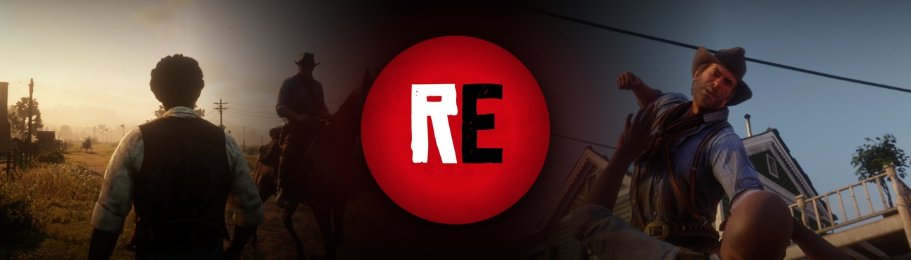
</p>

<h1 align="center">Redemption Editor</h1>

<p align="center">
  <b>A replay editor for Red Dead Redemption 2 on PC, in the spirit of the Rockstar Editor.</b><br>
  Record the scene around you, play it back, put cameras anywhere and export it as a video.
</p>

<p align="center">
  <a href="LICENSE"></a>
  <a href="https://github.com/rossignolli/redemption-editor/releases/latest"></a>
  
  
</p>

<p align="center">
  <a href="https://www.nexusmods.com/reddeadredemption2/mods/11299">Nexus Mods</a> ·
  <a href="https://github.com/rossignolli/redemption-editor/releases/latest">Download</a> ·
  <a href="https://redemption-editor.vercel.app">Website and videos</a> ·
  <a href="docs/architecture.md">Architecture</a> ·
  <a href="CONTRIBUTING.md">Contributing</a>
</p>

---

<p>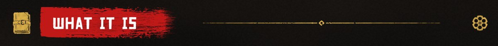</p>

## What it is

Ever wished Red Dead Redemption 2 had a Rockstar Editor? Now it does. Redemption Editor records everything happening
around you in Story Mode (people, horses, wagons, trains, guns, props, explosions, sounds, the weather and the sky) and
plays it all back the way it happened. Then you get to be the director: drop cameras anywhere, cut between shots, add
smooth camera moves, slow motion and depth of field, and export the whole thing as a video with the game's own sound.

Under the hood it is three small binaries: a Script Hook RDR2 script that records and plays back, a ReShade add-on, and
an editor core that draws the interface and runs the video export. A replay is not a video: it's a stream of engine
state (skeleton poses straight from the engine's pose finalizer, transforms, appearance, events) that gets put back on
inert puppets while the replay owns the world. This page is the player's quick start and the contributor's map of the
code. If you just want to play, the [Nexus page](https://www.nexusmods.com/reddeadredemption2/mods/11299) is the
friendlier read.

It's free software under GPL-3.0. Read it, learn from it, break it, improve it.

> [!WARNING]
> **Story Mode only.** Please don't use it in Red Dead Online. **Save before you watch a replay:** while a replay plays
> it takes over the world, and when you leave it the game loads your latest save.

<p align="center">
  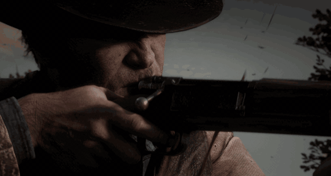
</p>

<p></p>

## Features

###  Recording

- **Replay buffer.** The last 60 seconds are always kept in a ring; **Shift+F4** saves them as a clip. Length and memory
  are in Replay Settings.
- **Manual recording.** **F4** starts, **F4** saves, no time limit. A long take is saved in parts (`-p1`, `-p2`...),
  each its own clip, closing at 900 MB by default (about 2 to 3 minutes in a busy town), with a notice every time.
- **The whole scene, not just you:** characters with their outfits, faces and expressions, horses with their tack,
  **muscles and sweat**, wagons, coaches and trains, guns and their wear, props that move, break or get thrown, ropes,
  doors, voices, **your character's pain sounds**, footsteps, gunshots, fist fights, blood and decals, fire,
  explosions, the time, the weather, the sky and the game camera.
- Dead Eye, kill cams and (if you want) cutscenes are part of the recording. The REC indicator can be normal, brief,
  hidden from screen recorders, or off.

###  Editing and cameras

- A clip gallery (**Recorded Clips** comes first), a timeline with frame steps, smooth scrubbing and speeds from 5% to
  200%, clip start and end, copy, paste, undo and redo.
- **Camera markers:** the game camera, the free camera or orbit presets; look at and attach to anyone or anything down
  to a bone; hard cuts or linear, smooth and spline blends; per marker slow motion, field of view, depth of field,
  photo mode filters and fades.
- **Camera shake per marker**, from presets or full control, including two one shots that fire at their marker:
  **Explosion** and the new **Gunshot** (a short recoil kick).
- **Free camera (F11):** classic or drone flight, acrobatic rotation, walk mode, collision, follow and lock onto a
  target. While you edit a marker it always flies level.
- **Time of day and weather** of any clip, buffer clips included.
- **Projects:** several clips stitched together, each with its own trim and cameras. Rename a project from the list
  or while it's open (**R**).

<p align="center">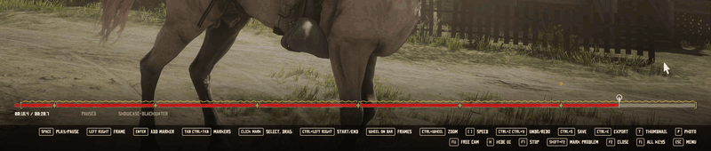</p>

###  Playback fidelity

- Skeleton poses come from the engine's pose finalizer and are written back through it, so the puppets move exactly as
  recorded, faces and fingers included.
- Recorded peds are kept at full animation detail while recording, even off camera, so nobody freezes in a pose.
- Horse muscles and sweat are recorded from the engine's own shader variables and given back to each horse.
- Speech, pain sounds, footsteps, shots, effects and decals are replayed through the engine's own systems.

<p align="center">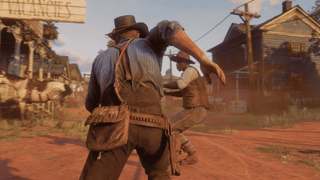</p>

###  Export

- **Ctrl+E** renders frame by frame on a locked clock, so it never drops a frame, however slow the PC.
- Real motion blur (several game frames per video frame), letterbox, film grain, LUTs and the game's sound.
- H.264, H.265 and AV1 on the GPU (NVENC, AMF or Quick Sync), ProRes, DNxHR, FFV1 and PNG on the CPU. Markers can
  become chapters, and exports can be queued.

###  Interface and languages

- A painted menu in the style of the game's own: boxed rows, an **ink cursor** and painted icons, made for 1080p,
  1440p and 4K.
- **Replay Settings** grouped as Recording, Playback, Storage and Interface, with an **Interface scale** from 80 to
  125%.
- 13 languages that follow the game's language. **F1** lists every key of the screen you're on; every key can be
  changed in `RedemptionEditor.ini`.
- **Easy bug reports:** **Shift+F2** marks a moment, **Shift+F1** packs the log, your marks and those clips into one
  ZIP.

<p align="center">
  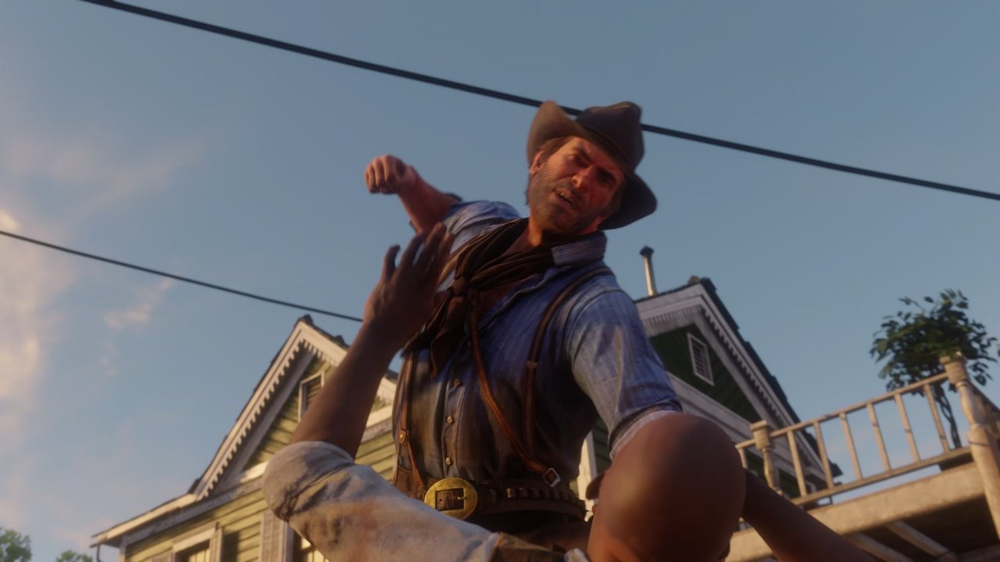
  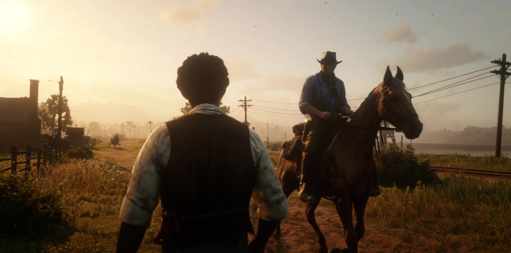
  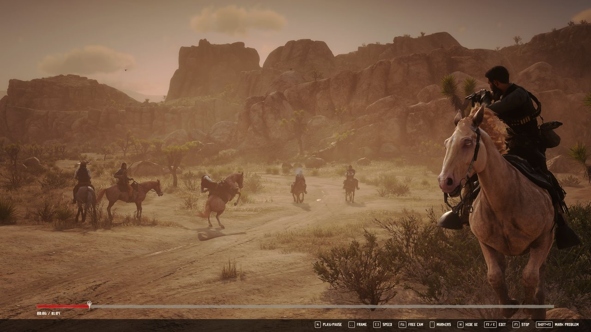
  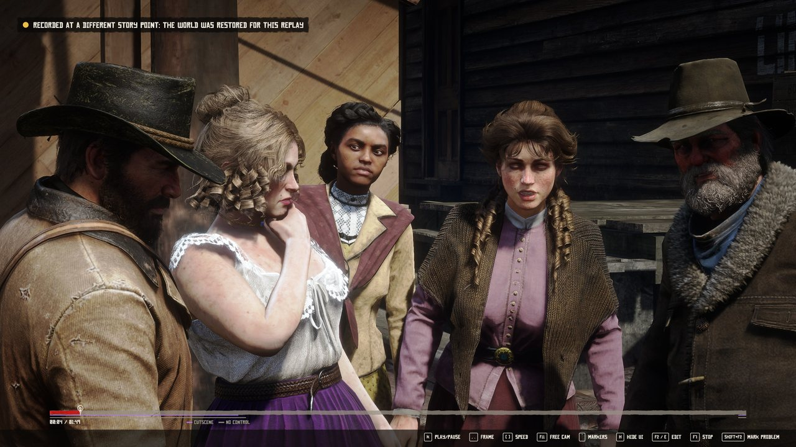
</p>

<p></p>

## Screenshots

The editor in game, at 4K (click for full size).

<p align="center">
  <a href="docs/img/ui-home-menu.jpg">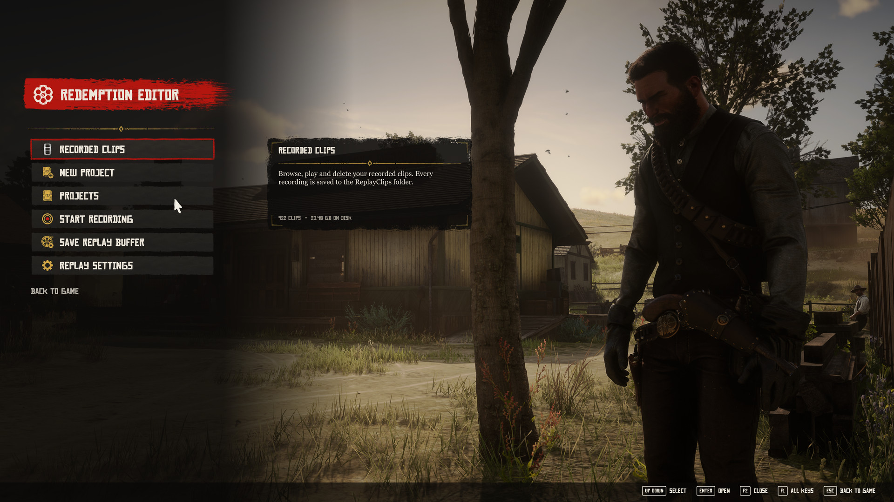</a>
  <a href="docs/img/ui-recorded-clips.jpg">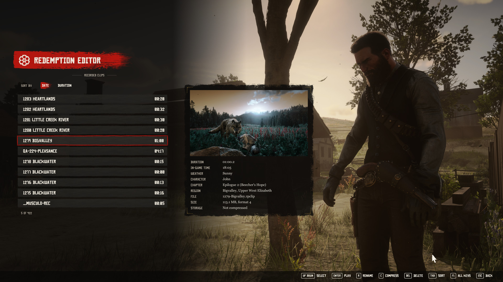</a>
  <a href="docs/img/ui-clip-editor-shake.jpg">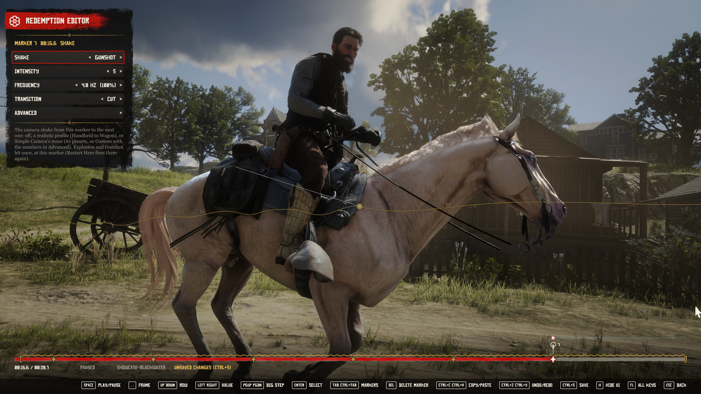</a>
  <a href="docs/img/ui-free-camera.jpg">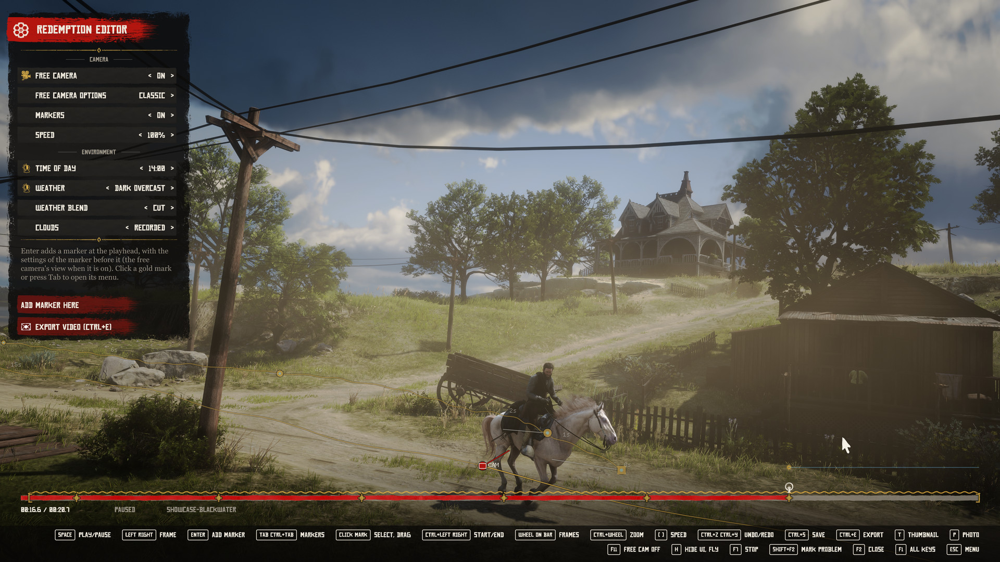</a>
  <a href="docs/img/ui-project-editor.jpg">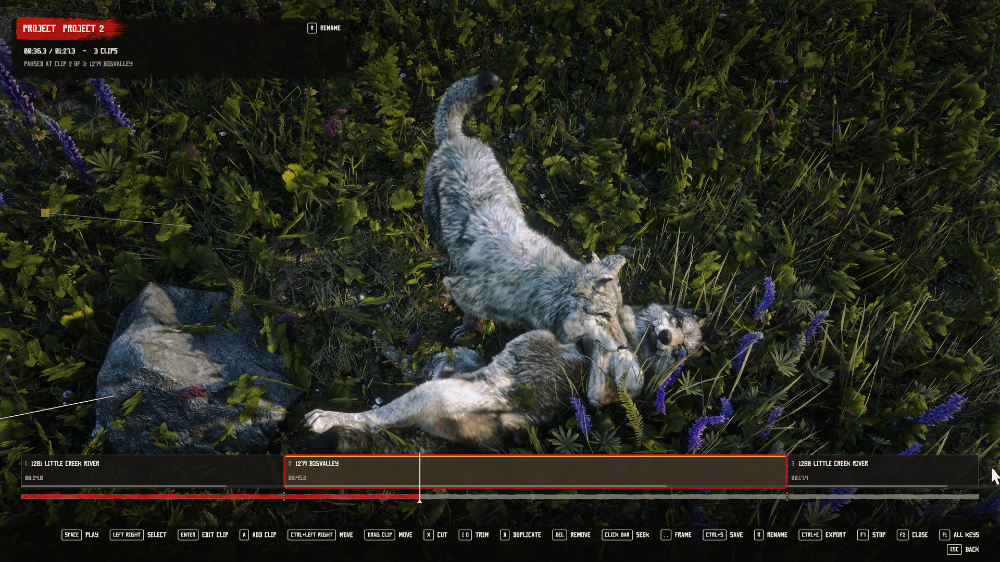</a>
  <a href="docs/img/ui-export.jpg">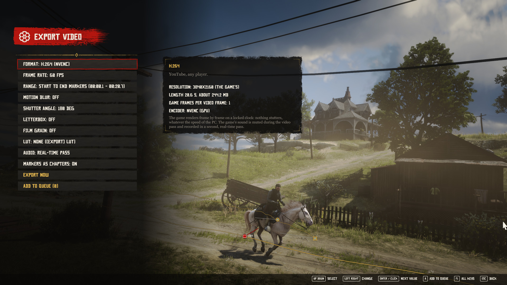</a>
  <a href="docs/img/ui-replay-settings.jpg">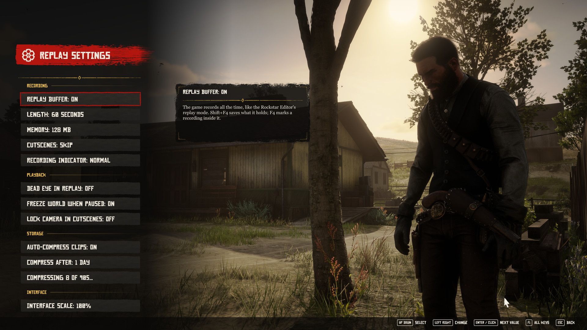</a>
  <a href="docs/img/timelapse.mp4">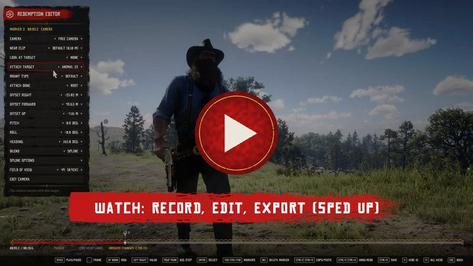</a>
</p>

<p></p>

## Install

1. Install [Script Hook RDR2](http://www.dev-c.com/rdr2/scripthookrdr2/) and [ReShade](https://reshade.me) **with
   full add-on support** for `RDR2.exe`.
2. Download the ZIP from [GitHub Releases](https://github.com/rossignolli/redemption-editor/releases/latest) or
   [Nexus Mods](https://www.nexusmods.com/reddeadredemption2/mods/11299) and copy everything inside it into the game
   folder (the one with `RDR2.exe`).
3. Start Story Mode, press **Shift+F4** to save the last 60 seconds, then **F2** to open the editor.

**Requirements**


| | |
|---|---|
| Game | Red Dead Redemption 2 on PC, build **1.0.1491.50**. Tested on Steam; the Epic Games Store and Rockstar Games Launcher versions should work too, so tell us in an issue how it went. |
| Script Hook RDR2 | by Alexander Blade (`ScriptHookRDR2.dll` and its `dinput8.dll` ASI loader). |
| ReShade | **6.6.2 to 6.8.x with full add-on support.** Without it the mod still records (F4, Shift+F4) and plays the last clip (F7), but the editor and the export don't open. |
| Graphics API | **Vulkan or DirectX 12.** Recording, playback and the editor work on both; the **video export needs Vulkan**. |

**Game in Program Files?** Nothing to change. Windows doesn't let the game write to `C:\Program Files` (the
Rockstar Games Launcher's default, and Steam's `C:\Program Files (x86)`), so the mod checks at start and, when the game
folder is read only, keeps your clips, projects, reports, its log and the settings you change in
`Documents\Rockstar Games\Red Dead Redemption 2\Redemption Editor` instead. Clips already in the game folder still
show and open. Details in [docs/configuration.md](docs/configuration.md#where-the-mod-writes).

**Coming from a test build?** Delete the old `RedemptionEditor.*` files and the `RedemptionEditor\` folder first, and
let the new `RedemptionEditor.ini` replace yours. Your clips and projects stay.

**Open source:** the full source is right here, so anyone can read it and build the mod themselves.

**Uninstall:** delete `RedemptionEditor.asi`, `RedemptionEditor.addon64`, `RedemptionEditorCore.dll`,
`RedemptionEditor.ini`, the `RedemptionEditor.*log` files and the `RedemptionEditor\` folder from the game folder.
Your recordings live in `ReplayClips\` and `ReplayProjects\` (in the game folder, or in
`Documents\Rockstar Games\Red Dead Redemption 2\Redemption Editor` when the game folder is read only); delete them,
`ReplayReports\`, `ReplayDebug\` and `%LOCALAPPDATA%\RedemptionEditor` too if you don't want them anymore.

Keys, settings and the files the mod writes are in [docs/configuration.md](docs/configuration.md). Every key can be
changed in the `[Keys]` section of `RedemptionEditor.ini`.

<p></p>

## How it works

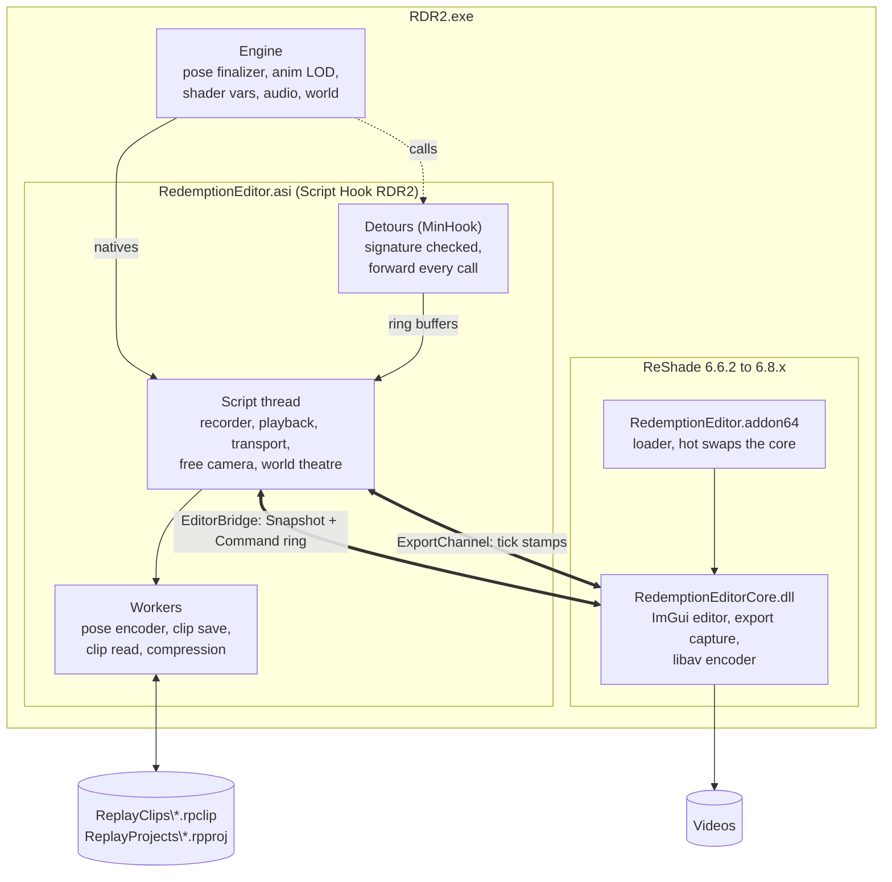

### Three binaries, one game

| Binary | Project | Runs in | Job |
|---|---|---|---|
| `RedemptionEditor.asi` | `ReplayProbe.vcxproj` (`main.cpp`, `script.cpp`, `src/`) | Script Hook RDR2's script thread | recording, playback, the free camera, the world takeover, clip files |
| `RedemptionEditor.addon64` | `ReplayEditorLoader.vcxproj` (`editor/editor_loader.cpp`) | ReShade | loads a copy of the core, forwards ReShade's events, swaps the copy between two frames when the file changes |
| `RedemptionEditorCore.dll` | `ReplayEditor.vcxproj` (`editor/`) | ReShade's overlay and present callbacks | the ImGui editor and the video export (`editor/render_export/`, FFmpeg's libav in process) |

The ASI and the core never call each other. They talk through two named shared memory blocks per game process:

- **The editor bridge** (`src/editor_protocol.h`, `src/editor_bridge.cpp`), `Local\RedemptionEditor.EditorBridge.v<N>.<pid>`.
  The ASI publishes a `Snapshot` (transport state, the clip in memory, its markers, the gallery, projects, targets)
  under a sequence lock, and drains a ring of 256 `Command` slots that the editor fills (play, seek, add a marker,
  open a clip, export). Both sides check a magic, a transport version, an API version, the struct size and the process
  id, and refuse a mismatch, so an ASI and a core from different builds never misread each other.
- **The export channel** (`src/export_channel.h`). During an export the ASI runs a fixed step export clock and writes
  one `TickStamp` per tick; the core captures each presented frame at the overlay point (the game and ReShade
  effects, before the editor UI), matches it to its stamp, accumulates motion blur samples in a compute shader and
  queues finished frames to the encoder. When the queue is full it blocks the present: with a fixed timestep, a wait
  changes nothing in the picture. The audio is a second, real time pass muxed in at the end.

### Touching the engine: the ladder

Every feature uses the lowest rung that works (details in [docs/architecture.md](docs/architecture.md)):

1. **Natives** through Script Hook RDR2, on the script thread.
2. **Guarded reads** of engine fields whose layout was proven for build 1.0.1491.50, inside SEH (`src/guarded_memory.h`).
3. **Guarded writes** of plain fields, only on objects the replay owns (its puppets, their weapons, its ropes).
4. **Calls to engine functions**, only after the function's first bytes match the expected signature at its RVA.
5. **Detours** (MinHook), with the same signature check. A detour forwards every call to the original and changes
   behaviour only for replay entities, or for the world while the replay owns it.

A signature mismatch turns that feature off and logs it; nothing ever falls back to a guessed address. Detours never
call natives: they copy what they need into a ring buffer the script thread reads on its next tick. Enabling hooks
freezes every game thread for 60 to 160 ms, so they are queued and applied in one batch (`src/hook_batch.h`). The main
detours:

| Detour | File | What it's for |
|---|---|---|
| Pose finalizer | `src/pose_capture.cpp` | **Recording:** copies each armed skeleton's pose buffer and world matrix into a per entity ring. **Playback:** the pose override writes the recorded pose after the finalizer, so animation can't overwrite it. The slot is shared with other mods through `src/finalizer_owner.h`. |
| Anim LOD | `src/anim_lod_hook.cpp` | Hands the recorded peds' anim directors LOD 0 and "visible", so peds off camera keep animating at full detail while you record (no frozen faces or sliding walks). |
| Shader vars | `src/shader_vars_hook.cpp` | Reads the creature shader vars (horse muscles and sweat) while recording, and writes the recorded values into the puppet's buffer at the animation job's write node during playback. |
| Audio observers | `src/audio_observer.cpp`, `src/sound_census.cpp` | Read only taps on the sound creators and speech entry points: what a replayed sound or line needs (voice, context, variation, callers), and a census of sounds per owner that compares a playback with its recording. |
| World theatre | `src/world_theatre_engine.cpp` | Population funnel, persistent characters, emitters: the engine side of the world takeover. |
| And more | `src/*_observer.cpp`, `src/ped_audio_state.cpp`, `src/render_target.cpp`... | Fire, effects, decals, fragments, weapons, water, the puppets' foley and footsteps, render targets, wind and the export timer. |

Every engine switch a player might need to turn off is a **support switch**: read by the public build, all on, never in
the shipped ini (`kSupportSwitches` in `src/ini_public.h`, listed in
[docs/release/troubleshooting-keys.md](docs/release/troubleshooting-keys.md)).

### Recording

`src/replay_capture.h` decides which engine entities enter the recording (a proximity scan with a capacity per class,
plus the player, his mount and vehicle and their dependents) and registers each one: skeleton layout, appearance, pose
record. A recording is a set of tracks of timestamped packets, one track per kind of data, keyed by a packed
`ReplayId`: lifecycle events (create, delete, attach with bone and offsets), transforms, poses, appearance, weapon
state, ropes, doors, speech, footsteps, shots, sounds, effects, decals, fire, and world state (time, weather, sky, map
pieces). Camera markers are a separate track, so editing cameras never touches entity data.

- **The pose stream** (`src/pose_stream.h`) is the bulk of a clip. Frames are grouped in chunks; each chunk starts with
  a keyframe (a full anchor, or a relative keyframe against the anchor), so any chunk decodes on its own and seeks never
  scan the whole clip. Between keyframes a frame carries only the channels that moved more than an epsilon since the
  value the decoder already holds, which bounds the error and stops drift. Rotations are packed in 32 or 64 bits,
  translations in 16 bit fixed point or floats. When a skeleton changes (a hat lost, a head shot) the entity goes on in
  a new **pose segment** (`src/pose_segments.h`).
- **The buffer ring** (`src/replay_buffer.h`). The always on buffer is a rolling ring on top of the recording: every
  block it drops, the heavy per frame tracks lose what lies before the ring's head and the oldest pose chunks go.
  Shift+F4 cuts the ring with `src/recording_window.h`: the clip starts at the start of the lifecycle block that holds
  the window's first moment (every block begins with the full create and attach state of each live entity), and every
  track is cut by how playback reads it (one shots dropped, state tracks carried in).
- **Manual recording** (F4) is the same recorder without the ring. Every block (2 s) it checks `ManualMaxMB` and
  `ManualMaxSeconds`; a full part is saved as its own clip (`-pN`) and a new recording starts right away. If a part
  fails to save, it is kept in memory and retried, and no new part starts.

### The clip format

A clip (`ReplayClips\NNN-Place.rpclip`, `src/clip_file.h`) is a header (`RPOCCLIP`, format version, duration) and one
versioned section per track (`u32` fourcc tag, `u16` version, `u64` length, payload). Session values never reach the
file: script handles and heap pointers are written as 0, and pointers into the game image are stored as offsets from
the image base and rebased on load. A clip carries the game build it was recorded on and refuses to open on another
one. `Load` refuses an unknown, duplicated or missing required section and names it; an optional section it can't
read is left out and the clip still opens.

On disk, clips are kept in the **packed container** (`RPOCPACK`, `src/clip_pack.h`), which is lossless: unpacking gives
back the exact bytes of the clip, so the parser never changes.

- The pose and rope sections are split into one stream per field, each value stored as the difference from the
  previous value of the same channel, ordered by track, channel and time so animation loops repeat close together.
  Record times and offsets are rebuilt from the records. Everything else goes into a "rest" stream unchanged.
- Each stream is cut into blocks of up to 32 MB, each compressed alone (LZMA, zstd or stored), so blocks decode on
  several threads and a clip opens in under a second.
- The save queue (`src/clip_save_queue.h`) writes every clip **already packed**: the transform plus zstd level 3
  blocks on four threads, unpacked again and checked against the clip's hash before the file is written (if packing
  fails, the clip is written plain). A low priority background worker (`src/clip_compress_worker.cpp`) repacks clips
  you haven't opened for `CompressAfterDays` (1 by default) with LZMA, about 40% smaller than a plain zstd frame. Clips
  from older builds (a single zstd frame) still open and get repacked.

A project (`ReplayProjects\*.rpproj`, `src/replay_project.h`) lists up to 512 clips with their own trims and cameras.

### Playback: puppets and the theatre

Playback creates an inert **puppet** for each recorded entity (`src/pose_playback.h`): built from the recorded model,
its appearance rebuilt (`src/entity_appearance.cpp`), with no AI, ragdoll, collision, damage or physics drift, placed
every frame at the recorded world transform, its skeleton posed by the finalizer override. No task, weapon or velocity
native is allowed on a puppet. Events (speech, sounds, effects, decals) are replayed through the engine's own systems.

One object owns the **playhead** (`src/replay_transport.h`): play, pause, hold (entities still loading), scrub, frame
steps and seeks all go through it, and everything else reads the time from it.

While a replay plays it owns the world (`src/world_model.h`, `src/world_theatre.h`, support switch `WorldModel`): on
the first playback the world is cleared (persistent characters held, vehicles and peds removed, the game's script
threads paused every tick, ambient spawns denied at their single funnel, static emitters reset), and when you leave
the replay the latest save is reloaded. During a mission nothing is cleared nor reloaded; the world is only hidden.
Each internal function is checked at its RVA before use, and a mismatch turns that part off for the session.

### Threads

| Thread | What runs there |
|---|---|
| Script thread (Script Hook's fiber on the game's main thread) | every native call, recording, playback, the transport, the free camera |
| Engine threads, inside detours | copies into ring buffers, never a native |
| ASI workers | pose encoder and discovery, clip save and read, background compression, deferred log writer, crash dump writer |
| ReShade's render thread | the editor UI and the export capture; reads the snapshot, writes commands, never touches engine state |
| Core workers | encoder, audio capture, file finisher, thumbnail decoding |

Every thread the mod creates is named (`src/thread_names.h`), so a crash log or minidump says whose thread faulted.
More in [docs/architecture.md](docs/architecture.md).

<p>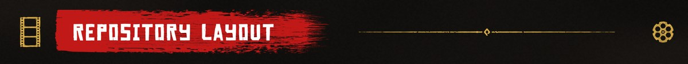</p>

## Repository layout

| Path | What's there |
|---|---|
| `main.cpp`, `script.cpp`, `script.h` | the ASI entry point and the script loop: keys, recording modes, playback control, notices |
| `src/` | the mod: recorder (`replay_capture.*`, `replay_recording.h`), pose capture and codec (`pose_capture.*`, `pose_stream.*`, `pose_playback.*`), clip files (`clip_file.*`, `clip_pack.*`, `clip_compress*`), playback (`replay_playback.*`, `replay_events.*`, `replay_objects.*`), world takeover (`world_*`), detours (`*_hook.cpp`, `*_observer.cpp`), the editor bridge and export channel, the ini (`ini_public.h`, `mod_identity.h`) and translations (`i18n.h`) |
| `src/*_core.h`, `*_rules.h` | pure logic without natives, unit tested |
| `editor/` | the ReShade add-on loader (`editor_loader.cpp`) and the editor core (`replay_editor_addon.cpp`, `ui_art.h`, `display_font.h`...) |
| `editor/render_export/` | the export: GPU capture and accumulation (`gpu_export.*`, `shaders/`), the libav encoder (`libav_encoder.*`), audio loopback |
| `editor/lang/` | the interface languages (`en.lang` is generated, the others are translations) |
| `editor/ui/`, `editor/fonts/` | the painted interface art and the title font |
| `tests/` | `ReplayCoreTests`, one file per area |
| `tools/clip_tool/` | `ReplayClipTool`, a command line reader for `.rpclip` and `.rpproj` files |
| `tools/ui_harness/` | the UI harness: every editor screen drawn with the real ImGui on a WARP device |
| `tools/i18n/` | `lang_table.py`, the language file generator and checker |
| `tools/ffmpeg/` | the vcpkg recipe, triplet and checks for the bundled FFmpeg |
| `tools/release/` | packaging and the configuration page generator |
| `tools/check_public_build.py`, `tools/audit_retail_only_architecture.py` | the static checks of the public build |
| `dist/RedemptionEditor.ini` | the shipped ini (written from `kShippedIni`) |
| `external/` | the ReShade submodule (headers, ImGui and MinHook), zstd, the FFmpeg recipe |
| `.github/ISSUE_TEMPLATE/` | the bug and crash report forms |
| `site/` | the project website |
| `docs/` | architecture, building, configuration, reporting and the dev build notes |

<p></p>

## Building from source

The full guide is [docs/building.md](docs/building.md). In short:

**Prerequisites**

- Visual Studio 2022 (toolset v143) with "Desktop development with C++" and a Windows 10 or 11 SDK.
- Git and Python 3 (for the checks in `tools/`).
- The ReShade submodule (pinned to 6.6.2, add-on API 18).
- The [Script Hook RDR2 SDK](http://www.dev-c.com/rdr2/scripthookrdr2/), which may not be redistributed, extracted to
  `external\ScriptHookRDR2_SDK\`, with `natives.h` generated from [alloc8or's native database](https://alloc8or.re/rdr3/nativedb/).
- FFmpeg built with vcpkg (only the editor core needs it; about an hour, once).

**Steps** (from a Developer Command Prompt)

```bat
git clone --recursive https://github.com/rossignolli/redemption-editor.git
cd redemption-editor
git submodule update --init external/reshade

:: Script Hook RDR2 SDK: extract it to external\ScriptHookRDR2_SDK\ (inc\ and lib\),
:: then replace inc\natives.h with the one generated at alloc8or.re (see docs/building.md)

git clone https://github.com/microsoft/vcpkg C:\vcpkg
tools\ffmpeg\install_ffmpeg.bat C:\vcpkg

msbuild RedemptionEditor.sln /p:Configuration=Release /p:Platform=x64 /m
```

Outputs go to `bin\Release\`: `RedemptionEditor.asi`, `RedemptionEditor.addon64`, `RedemptionEditorCore.dll` with its
`RedemptionEditor\` folder (FFmpeg DLLs, fonts, art, languages), `ReplayCoreTests.exe`, `ReplayClipTool.exe` and
`ReplayEditorUiTests.exe`. Don't use `/t:Rebuild` with a custom `OutDir` (its clean step can delete an earlier build's
files there); use `/t:Build`.

**Public and developer builds.** Same sources, two flavors:

- **public** (the default, the one in a release): reads only the keys listed in `src/ini_public.h`, and compiles no
  bench and no research probes;
- **developer** (`/p:RedemptionDev=true`, defines `REDEMPTION_DEV`): compiles the research probes and the test bench
  and reads every ini key. Build it into its own `OutDir` and `IntDir`:

```bat
msbuild RedemptionEditor.sln /p:Configuration=Release /p:Platform=x64 /p:RedemptionDev=true ^
  /p:OutDir=%CD%\bin\Dev\ /p:IntDir=%CD%\build\Dev\$(ProjectName)\ /m
```

The log's `CONFIG_BUILD` line says which flavor runs. Details: [docs/release/ini-and-dev-build.md](docs/release/ini-and-dev-build.md).

**Installing your build.** Copy the outputs next to `RDR2.exe`, or set `RDR2GameDir` (on the command line or once in
`RedemptionEditor.user.props`, copied from the `.example`) and every build copies itself there.

**Hot reload**
- **The ASI:** Script Hook RDR2 reloads `.asi` files with **Ctrl+R** while the game runs, when an empty
  `ScriptHookRDR2.dev` file is in the game folder. It only reloads ASIs that were loaded at game start: a new `.asi`
  file needs a restart.
- **The core:** the add-on loads a copy of `RedemptionEditorCore.dll` and swaps it between two frames when the file
  changes, so you can rebuild the core with the game running.
- **The add-on** (`RedemptionEditor.addon64`) is read by ReShade only at game start: changing it needs a restart.
- If you change the editor protocol (`kApiVersion`, `kSharedTransportVersion`), reload the ASI and the core together:
  each refuses the other's old layout.

<p></p>

## Testing

Run these from the repository root (they are also the [pull request checklist](CONTRIBUTING.md#pull-request-checklist)).

- **Core unit tests.** `bin\Release\ReplayCoreTests.exe` runs every group (clip files, pose codec, packed container,
  transport, camera, world model, i18n, ini...) and ends with `All retail-only core tests passed.` Run the developer
  build's copy too.
- **UI harness.** `ReplayEditorUiTests.exe --out <folder>` draws every editor screen at ten resolutions (1024x768 to
  3840x2160) with the real ImGui on a WARP device, checks the text layout and writes PNGs, `report.json`,
  `findings.txt` and a contact sheet `index.html`. Useful options: `--lang <code>` (and `--lang pseudo`: every text
  about 40% longer and accented), `--scale 80,100,125` (Interface scales), `--res 1920x1080,2560x1440`,
  `--filter <text>`, `--flat` (without the painted art). Exit code 0 means no error level finding.
- **Public build check.** `py tools\check_public_build.py`: the public build reads only public keys, the shipped ini
  matches `kShippedIni`, no bench is compiled into the public ASI, and the language files are sound.
  `py tools\audit_retail_only_architecture.py` and `py tools\release\gen_configuration_doc.py --check` go with it.
- **In game bench (developer build only).** The developer ASI watches `ReplayBench\inbox\` in the game folder for
  `*.scn` scenarios: one op per line (`teleport`, `spawn_ped`, `fight`, `record start`, `play`, `seek`, `scrub`,
  `mark`...; the parser is `src/bench_script.cpp`), executed on the script thread through the same entry points as the
  keys. The public build compiles none of it.
- **Frozen poses and blinks.** `ReplayClipTool frozen-poses <clip>` measures walking peds whose recorded pose repeats
  from frame to frame (`src/frozen_pose_check.h`). During playback the puppet blink detector (`src/puppet_blink.h`)
  logs every tick a body that should be on screen isn't drawn as recorded (hidden, unposed, bind pose or missing) as
  `PUPPET_BLINK` lines, with one `PUPPET_BLINK_SUMMARY` per playback.
- **ReplayClipTool** for clips: `sections` (the sections and the load verdict), `export <clip> <out.json>` (a readable
  dump), `segments` (pose segments per entity), `events`, `objects`, `speech`, `trim`, `pack-verify` (packs a clip and
  proves the round trip is byte exact, with sizes and timings) and `pack-load`. Run it with no arguments for the full
  list.

<p></p>

## Contributing

Contributions are welcome, from a translation fix to a new detour. The full guide is
[CONTRIBUTING.md](CONTRIBUTING.md); the short version:

- **Bugs:** in game, press **Shift+F2** at the moment something looks or sounds wrong, then **Shift+F1** to save a
  report ZIP, and attach it to a [Bug report or Crash report](https://github.com/rossignolli/redemption-editor/issues/new/choose)
  ([docs/reporting.md](docs/reporting.md) lists what's in it). Support happens on GitHub Issues only, so nothing gets
  lost.
- **Changes:** open an issue first for anything bigger than a fix, then a pull request from a branch of your fork.
- **Style:** match the code around you (C++17, four spaces, CRLF), everything in English, comments only where the code
  can't speak for itself (the why, the engine facts, the invariants), log lines as `NAME,key=value`.
- **The rules:** no leaked or proprietary game code or assets, ever. Every engine offset or function needs a
  signature check and a log line on its failure path. Fixes don't get public ini keys: a player setting goes in
  `src/ini_public.h`, an engine safety switch is a hidden support switch, everything else is a developer key.

<p></p>

## Translations

The interface speaks English, Brazilian Portuguese, Spanish (Spain and Latin America), French, German, Italian,
Polish, Russian, Japanese, Korean and Chinese (Simplified and Traditional), and follows the game's language.

Every player facing text goes through `TR("key", "English")` in the code. `editor/lang/en.lang` is generated from it by
`py tools\i18n\lang_table.py --write`, and each translation is `editor/lang/<code>.lang`, a plain `key = text` file.
To contribute a language or fix one:

1. Copy `en.lang` to `<code>.lang` (or open the existing one) and translate the text after each `=`, keeping every
   `{name}`. A missing line shows the English.
2. `py tools\i18n\lang_table.py --missing <code>` lists the keys still missing; `--check` validates every file.
3. Try it in game with `Language=<code>` in `RedemptionEditor.ini`, or in the UI harness with `--lang <code>`.
4. Open a pull request.

The translations were made with AI help. If you're a native speaker and something reads wrong, corrections are very
welcome.

<p></p>

## Known limitations

- **Story Mode on build 1.0.1491.50 only.** On another build the mod says so on screen, and parts of it may switch
  themselves off.
- **A replay takes over the world**, and your latest save loads when you leave. Save first.
- **Missions are left alone:** the world is only hidden, so some mission characters or props can show up.
- **The video export needs Vulkan** and ReShade 6.8 or older.
- **Water** is not recorded: the game's own water runs in the replay.
- **Props from other mods** placed before a replay are cleared when it starts; props placed during it stay.
- **A rare `ERROR: FFFFFFFF`** while the game reloads your save after a replay, mostly when the PC is low on memory.
  Your clips are safe.
- **Clips can get big:** a minute in a busy town can take a few hundred MB before the background compression.
- **Clips are tied to the game build** they were recorded on, and clips from a newer version of the mod may not open
  in an older one.
- **Other script mods** that change characters or the world can clash with a replay.
- **A read only game folder:** clips an earlier version saved there open, but the editor can't rename or delete them;
  a change to one is saved as a copy in the Documents folder.

<p></p>

## Privacy

There is no network code. The mod has no telemetry and never connects to the internet. Everything it writes stays in
the game folder (or `Documents\Rockstar Games\Red Dead Redemption 2\Redemption Editor` when the game folder is read
only), `%LOCALAPPDATA%\RedemptionEditor` and your Videos folder. A report ZIP is only made when you press
Shift+F1, and it only leaves your PC if you attach it somewhere yourself.

<p></p>

## Credits and acknowledgements

- **Alexander Blade**, for Script Hook RDR2.
- **crosire**, for ReShade and its add-on API.
- **crxhvrd**, for Simple Camera and REPlus, which inspired the free camera and the spline blends.
- The RDR2 research community, especially **alloc8or**'s native database and **femga**'s rdr3_discoveries.
- **EVER Enhanced**, whose in process FFmpeg approach the export follows.
- The **FFmpeg**, **x264**, **x265**, **LAME**, **zstd**, **LZMA SDK**, **MinHook**, **Dear ImGui** and **stb** projects.
- **Rockstar Games**, whose Rockstar Editor is the whole reason this mod exists.
- Our testers, for every crash log and every weird replay they sent our way.

Yes, AI tools helped write a lot of this code. Every feature, design call and fix was directed, tested in game and
reviewed by people.

Community: come show off your shots on [Discord](https://discord.gg/AJNeqYvn7H).

<p></p>

## Special thanks

A huge thank you to **DesmondW** and **leviksd**, who gave this mod countless hours of testing, sent report after
report and stayed patient through dozens of QA builds. Redemption Editor is a much better mod because of you two.

And thanks to **ObscureOutlaw**, **Desse** and **Muz**, who tested, reported and helped us hunt down the weird stuff.

<p></p>

## License

Redemption Editor is free software under the [GNU General Public License, version 3](LICENSE). Third-party code and
assets, and their licenses, are listed in [THIRD_PARTY_NOTICES.md](THIRD_PARTY_NOTICES.md). The release carries the
exact sources of the bundled FFmpeg, x264, x265 and LAME (with the vcpkg recipe and patches they were built with) as
`RedemptionEditor-<version>-ffmpeg-sources.zip`.

Redemption Editor is a fan-made mod. It is not affiliated with, endorsed or sponsored by Rockstar Games or Take-Two
Interactive. Red Dead Redemption is a trademark of Take-Two Interactive Software, Inc.

<p></p>

## Support and contribute

Redemption Editor is free and always will be. There are three ways to help it grow.

<p align="center"><a href="https://patreon.com/VitorRossignolli"></a></p>

- **Support the project.** If the mod made you a video you're proud of and you'd like to give something back,
  [Patreon](https://patreon.com/VitorRossignolli) is the place. If you're a content creator and the videos you make
  with Redemption Editor earn you money, please consider supporting the project. It keeps the tool evolving and pays
  for the time new features take.
  <!-- GitHub Sponsors: add its link here once the Sponsors profile is approved, plus the github line in .github/FUNDING.yml. -->
  On Nexus Mods, endorsing and downloading the mod also counts, through Donation Points. This is a one person
  project built in spare hours, so every bit of support goes straight into more time for it. No pressure, though:
  using it and sharing your shots is great too.
- **Contribute code.** Pull requests are welcome; [CONTRIBUTING.md](CONTRIBUTING.md) has the setup and the rules.
  Good places to start: a translation that reads wrong in your language (`editor/lang/<code>.lang`), a text that
  doesn't fit at some resolution or Interface scale (the UI harness finds those), more unit tests in `tests/`, and the
  docs. Bigger things, like a new detour or a clip format change, start with an issue.
- **Test and report.** Bug reports with a report ZIP are worth as much as code. In game, press **Shift+F2** at the
  moment something looks or sounds wrong, then **Shift+F1** to save the report ZIP, and attach it to a
  [Bug report or Crash report](https://github.com/rossignolli/redemption-editor/issues/new/choose). Playing on the
  Epic Games Store or Rockstar Games Launcher version? Telling us how it went helps too.
